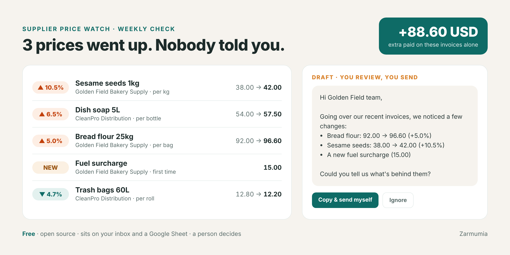

# Supplier Price Watch

**Catch the quiet price increases hiding in your supplier invoices. Free, and it sits on top of what you already use.**



> **About this repo:** a working demo from the [Zarmumia](https://zarmumia.co.il) portfolio. It shows the approach, not a finished product: rules a business owner can read, privacy first, a person makes every decision, and it builds on the tools a business already has.

Small businesses watch their sales closely and their costs much less. Supplier invoices go straight to the bookkeeper, nobody compares them with last month, and the flour goes up 5%, the cleaning supplies 6%, and a "fuel surcharge" shows up one day and stays. None of it is big enough to notice on its own. Together it eats the margin.

## Not another platform

Tools that catch supplier price changes exist, but they come as a whole new system: a monthly subscription (often hundreds of dollars), onboarding, and usually built for restaurants only. This is the opposite:

| | Cost-control platforms | Supplier Price Watch |
| --- | --- | --- |
| Price | Monthly subscription | Free, open source (MIT) |
| Setup | New system, onboarding, migrate your data | Point it at the folder or inbox your invoices already land in |
| Where the data lives | Their cloud | A plain CSV on your machine, or your own Google Sheet |
| Who it's for | Mostly restaurants | Any business that gets supplier invoices: clinics, salons, cafés, shops, contractors |
| What it does | A lot | One thing: tells you what got more expensive, and drafts the question to the supplier |
| Who decides | Often automated | You. Nothing is paid, disputed or sent automatically |

**Two ways to run it:**

- **No code:** paste [`prompt.md`](prompt.md) into a weekly scheduled task in Claude, connected to your email and a Google Sheet. That's the whole setup.
- **Python:** the CLI below, for a folder of PDFs, a cron job or your own automations.

## What you get

The tool reads your supplier invoices, keeps a simple price history, and tells you what changed:

```
[engine: demo · 5 invoice(s) read · history: prices.csv]

PRICE UP    Golden Field Bakery Supply: Sesame seeds 1kg per kg 38.00 USD -> 42.00 USD (+10.5%, since 2026-09-03, invoice GF-1163)
PRICE UP    Golden Field Bakery Supply: Bread flour 25kg per bag 92.00 USD -> 96.60 USD (+5.0%, since 2026-09-03, invoice GF-1163)
PRICE UP    CleanPro Distribution: Dish soap 5L per bottle 54.00 USD -> 57.50 USD (+6.5%, since 2026-08-11, invoice CP-5790)
NEW CHARGE  Golden Field Bakery Supply: "Fuel surcharge" 15.00 USD (first time, invoice GF-1163, 2026-10-02)
PRICE DOWN  CleanPro Distribution: Trash bags 60L (50) per roll 12.80 USD -> 12.20 USD (-4.7%, since 2026-08-11, invoice CP-5790)

3 price increase(s), 1 new charge(s). Extra paid on these invoices alone: 88.60 USD.
```

With `--drafts` it also writes a polite message to each supplier, for you to review and send yourself:

```
Hi Golden Field Bakery Supply team,

Going over our recent invoices, we noticed a few changes:
- Bread flour 25kg: 92.00 USD -> 96.60 USD per bag (+5.0%)
- Sesame seeds 1kg: 38.00 USD -> 42.00 USD per kg (+10.5%)
- "Fuel surcharge" (15.00 USD) appears for the first time on invoice GF-1163

Could you tell us what's behind them, and whether there's any flexibility given our regular orders?
```

## How it works

1. **Invoices in.** Drop supplier invoices (PDF) into a folder. Most suppliers already email them, and a Make / Zapier / n8n flow or a mail rule can save attachments to that folder.
2. **Read.** Claude turns each invoice into strict JSON: supplier, date, currency, and every line with its unit and unit price. Fees and surcharges count as lines.
3. **Validate.** Every field is checked. Malformed output is re-requested, and an invoice that still can't be trusted is skipped and reported, never guessed.
4. **Compare.** Each line is compared with the last price paid to the *same supplier* for the *same item* in the *same unit*.
5. **Report.** You get a short alert, the extra cost, and optional draft messages. `--webhook` sends it all to your email, Slack or a Google Sheet through your automation tool.

The price history is a plain `prices.csv` you can open in Excel or Google Sheets. Invoices already processed are skipped on the next run, so a weekly schedule only reports what's new.

## The rules

- **Same item** = same supplier + same product code (or, without one, the same description) + same unit. Different units are never compared.
- **A change is reported** when the unit price moves by at least the threshold (`--threshold`, default 3%).
- **A new fee** (delivery, fuel, handling, surcharge...) from a supplier you already buy from is reported the first time it appears.
- **Nothing is paid, disputed or sent automatically.** The tool finds, a person decides.

## Quick start

```bash
# Offline demo on the sample invoices, no API key needed
python -m supplier_price_watch samples/invoices --demo --drafts --business "Corner Bakery"

# Real invoices with Claude
export ANTHROPIC_API_KEY=...
python -m supplier_price_watch ~/invoices --drafts
python -m supplier_price_watch ~/invoices --json --webhook https://your-hook-url
```

No dependencies beyond Python 3.10+. The model is configurable with `ANTHROPIC_MODEL`.

To run it weekly, use cron, Windows Task Scheduler, or a scheduled task in your automation tool.

## Privacy

- **Text invoices** are redacted before anything is sent: emails, phone numbers, bank details, card numbers and long ID numbers are replaced with placeholders. Redaction is tested.
- **PDF invoices** are sent to the Claude API as documents, because layout matters for reading them. Only point the tool at invoices you're comfortable sending to the API under your agreement with Anthropic.
- The price history stays on your machine.

## Tests

```bash
pip install pytest && pytest
```

The tests cover redaction, strict parsing of messy model output, the comparison rules (threshold, units, suppliers, new fees, repeat runs), the report and drafts, and the Claude engine's retry and PDF paths with a mocked API.

---

Built by **Fanny Rabinovitch · Zarmumia**: operations, automation and AI workflows for small and growing businesses. Sample invoices and suppliers are fictional.
